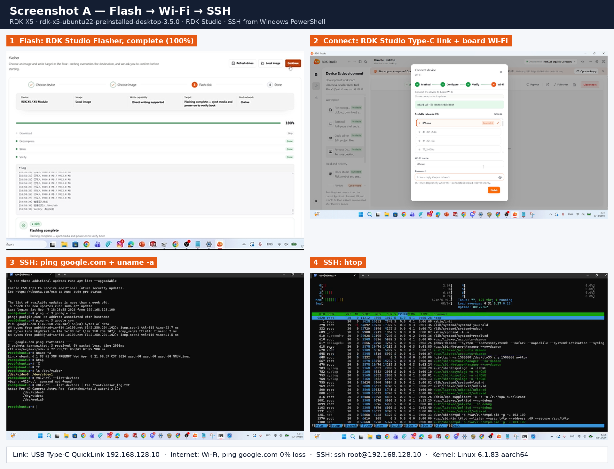
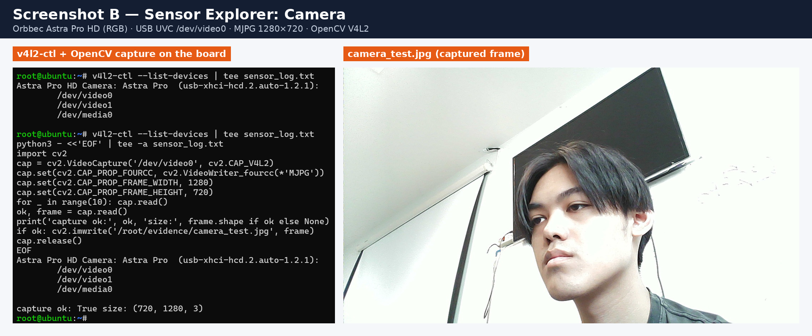
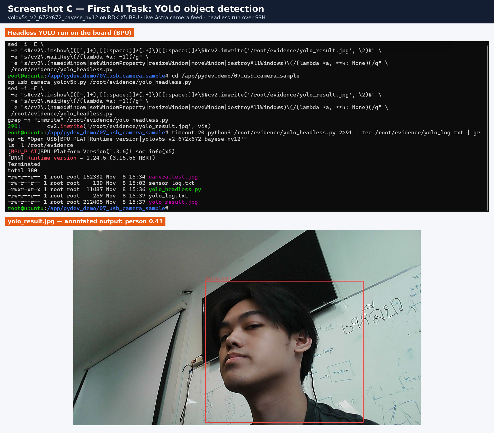

# RDK Dream Keeper Challenge — 2026 Winter

**Participant:** Apiluck Noppkun (Bruce) · [@banh0001](https://github.com/banh0001)
**Hardware:** D-Robotics RDK X5 · Orbbec Astra Pro HD camera · 2D LiDAR
**Challenge:** [Robotics Dream Keeper Challenge 2026 Winter](https://github.com/D-Robotics/Robotics-Dream-Keeper-Challenge-Winter)

My journey on D-Robotics RDK X5 — from first boot to an on-device AI robot.

**Project:** Service Robot Kit for Autonomous Navigation on RDK X5

## Progress

| Stage | Window | Status | Details |
| --- | --- | --- | --- |
| Stage 1 — Ignite | Nov 1–10, 2026 | ✅ Completed | [`stage1-ignite/`](stage1-ignite/) |
| Stage 2 — Build | Nov 11–26, 2026 | ⏳ Planned | Service Robot Kit for Autonomous Navigation (proposal coming) |
| Stage 3 — Launch | Nov 27 – Dec 15, 2026 | ⏳ Planned | — |

---

## Stage 1 — Ignite: Power On Your AI Robot's Brain

| Challenge | What I did | Interface / tool |
| --- | --- | --- |
| 1. Board bring-up | Flashed RDK OS 3.5.0 (desktop), connected over USB Type-C + Wi-Fi, SSH from Windows | RDK Studio Flasher · Wi-Fi · SSH |
| 2. Sensor explorer | Captured 1280×720 frames from an Orbbec Astra Pro HD | USB (UVC) `/dev/video0` |
| 3. First AI task | YOLOv5s object detection on the BPU with the live camera feed, run headless over SSH | BPU · `hbm_runtime` |

Full steps, commands, dependencies and troubleshooting: **[stage1-ignite/README.md](stage1-ignite/README.md)**

### Screenshot A — Flash → Wi-Fi → SSH


### Screenshot B — Camera (Orbbec Astra Pro HD over USB)


### Screenshot C — YOLO object detection on the BPU


### Quick reproduce

```bash
# SSH into the board
ssh root@192.168.128.10

# Camera check
v4l2-ctl --list-devices

# YOLO on the live USB camera (headless copy, see stage1-ignite/README.md)
cd /app/pydev_demo/07_usb_camera_sample
timeout 20 python3 -u /root/evidence/yolo_headless.py
```

---

## Hardware

| Item | Details |
| --- | --- |
| Board | D-Robotics RDK X5 (8× Cortex-A55, 10 TOPS BPU) |
| OS | RDK OS 3.5.0, Ubuntu 22.04 |
| Storage | 64 GB microSD |
| Power | USB Type-C 5V/5A adapter |
| Camera | Orbbec Astra Pro HD (RGB stream used in Stage 1) |
| LiDAR | 2D LiDAR (for Stage 2–3 navigation) |
| Host PC | Windows 11 + RDK Studio |

## Repository layout

```
.
├── README.md            # this page
├── LICENSE
└── stage1-ignite/
    ├── README.md        # full Stage 1 guide
    ├── images/          # Screenshot A, B, C
    ├── evidence/        # logs and raw images from the board
    └── scripts/         # camera capture script
```

## Links

- Discord Stage 1 check-in: [personal thread](https://discord.com/channels/1300358874280230994/1563152274644144208)
- Showcase PR: [#3](https://github.com/D-Robotics/Robotics-Dream-Keeper-Challenge-Winter/pull/3)

## License

My own files are released under the [MIT License](LICENSE).
D-Robotics sample code and models are referenced, not redistributed, and remain under their original licenses.
